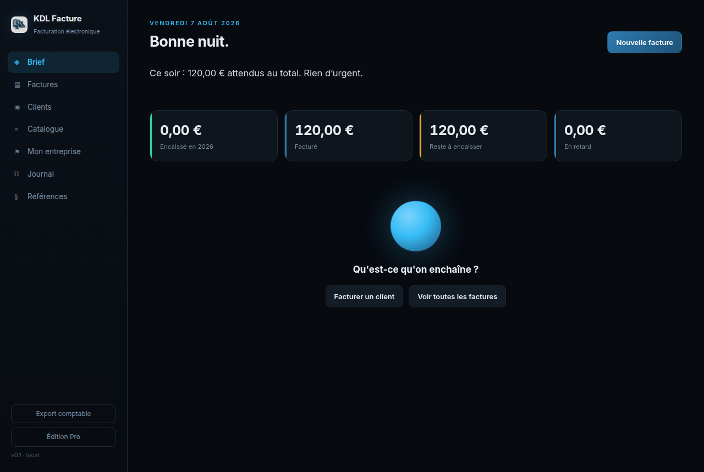

[Français](README.md) · **English**

# KDL Facture

French electronic invoicing, compliant with the 2026 reform. One executable per
platform, nothing to install, your data never leaves your machine.

Built by **KDL TECH** — IT support, software development, security.



---

## What it does

**Factur-X electronic invoices**, EN 16931 profile: a PDF/A-3 you can read with
your eyes, with the structured XML stapled inside it. Your client's accounting
software pulls the data straight out — no re-keying.

**The mentions the reform requires** — the client's SIREN, the delivery address
when it differs, the transaction category, the VAT-on-debits option.

**Thirteen tax territories**, because VAT is not the same everywhere in France:
20% in mainland France, special rates in Corsica, 8.5% in the West Indies and
Réunion, no VAT at all in Guyane or Mayotte, and collectivities with their own
tax regimes. The territory is suggested from the postal code and stays editable.

**VAT exemption by default** — the regime a new business starts on. Invoices then
carry no VAT, the article 293 B mention is added automatically, and the dashboard
tracks the year's collected revenue with a warning as the threshold approaches.
VAT-registered businesses switch in one click.

**Arithmetic exact to the cent**: everything in whole cents, VAT grouped by rate
and never summed line by line.

**An issued invoice never moves again**: sequential numbering assigned only on
issue, SHA-256 fingerprint, corrections by credit note only. A hash-chained audit
log records every act — alter one row and the chain breaks, and the software says so.

**An issuing mistake can be taken back, leaving no gap.** As long as an invoice
carries the last number assigned, has collected nothing and is targeted by no
credit note, the issue can be cancelled: the document returns to draft — editable
or deletable — and its number goes back into the counter for the next invoice.
In the middle of the sequence it is refused: renumbering invoices already handed
to clients would mean rewriting history, and the credit note remains the way. A
numbering check lists any gaps and duplicates, per type and per year.

**A compliance check** refuses to issue an invoice that would be rejected on the
client's side, and tells you exactly what is missing.

Also: quotes, credit notes, deposits, partial payments, overdue tracking, CSV
accounting export, several businesses in one database.

## What it does not do

**Transmission.** Article 289 bis of the French tax code requires an accredited
platform. KDL Facture produces the compliant file; filing it is a separate step.

**E-reporting** of sales to private individuals — an obligation that starts on
1 September 2027.

---

## Installation

None. Download the executable for your system and run it: the interface opens in
your browser at `http://127.0.0.1:4310`, loopback only.

| System | File |
|---|---|
| Linux x64 | `KDL-Facture` |
| Windows x64 | `KDL-Facture.exe` |
| macOS Apple Silicon | `KDL-Facture-mac` — right-click → Open on first launch |

Your data lives in a single SQLite file, worth backing up:

- Linux `~/.local/share/kdl-facture/facture.db`
- Windows `%APPDATA%\kdl-facture\facture.db`
- macOS `~/Library/Application Support/kdl-facture/facture.db`

---

## Development

```bash
npm install          # dependencies
npm test             # 69 tests, no network, no database on disk
npm start            # local server on port 4310
node build/construire.mjs   # all three executables
```

The build expects the official Node runtimes in `build/runtimes/`. Two traps
worth knowing: the SEA blob must be prepared by the **same Node version** as the
one it is injected into, and the SEA asset mechanism does not handle binary
files — so the interface is base64-encoded into the bundle.

### Architecture

| File | Role |
|---|---|
| `src/calculs.js` | Cent-based arithmetic, VAT breakdown by rate |
| `src/territoires.js` | The thirteen tax territories and 107 departments |
| `src/facturx.js` | EN 16931 CII XML and compliance checking |
| `src/pdf.js` | PDF/A-3 with the XML embedded |
| `src/factures.js` | Issuing, numbering, credit notes, hash-chained log |
| `src/api.js` | HTTP API, loopback only |
| `src/db.js` | SQLite via `node:sqlite`, gentle migrations |

---

## Editions

| | Découverte | Pro |
|---|---|---|
| Price | free | €49 once |
| Compliant Factur-X invoices | ✓ | ✓ |
| Tamper-evident log, credit notes | ✓ | ✓ |
| All territories and VAT regimes | ✓ | ✓ |
| Invoices per calendar year | 15 | unlimited |
| Catalogue, quotes, deposits | — | ✓ |
| Accounting export, threshold tracking | — | ✓ |
| Multiple businesses | — | ✓ |

**What makes an invoice compliant stays free.** A small business should not have
to pay to obey the law: Découverte produces fully valid invoices, with no
watermark and no advertising. What you pay for is volume and comfort.

The licence is a signed file placed next to your data. No online activation, no
subscription: the software runs on a machine with no internet at all.

## Licence

Source-available — see [LICENCE.md](LICENCE.md). You may read, audit, compile and
use it; you may not resell it. The code of a program that calculates your
invoices should not be a black box.

## Sources

The rules applied come from official texts, listed in the **Références** tab
inside the software: impots.gouv.fr, Légifrance, service-public.fr, URSSAF. When
in doubt, the official source prevails — not this software.

---

